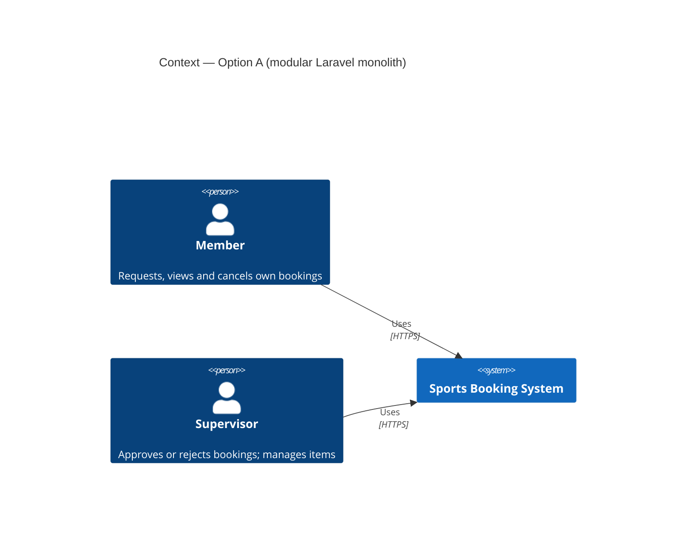
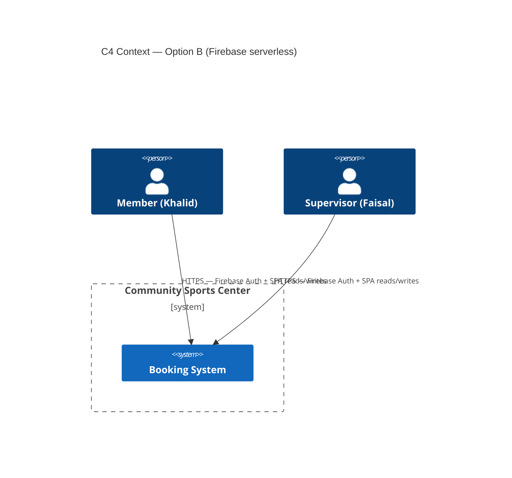

# M1 Architecture — First Draft (Sports Field & Equipment Booking System)

**Milestone:** M1 · **Status:** v2 — human-reviewed · **Date:** 2026-10-21
**Author / reviewer:** Abdullah Alhirbish

**Decision:** Option A — modular Laravel monolith (see ADR-001). Option B — serverless Firebase — was evaluated and rejected.

---

## 1. Distinctness check — are the two options really different?

The first AI draft (v1) offered "Laravel + Blade" vs "Laravel API + SPA": same backend, same database, same modules, same concurrency mechanism, same cost. That is one design with two frontends, so it was rejected and a second draft was requested. The final two options differ on every structural dimension:

| Dimension | Option A — Modular monolith | Option B — Serverless / BaaS |
|---|---|---|
| Architectural style | One server-side application | Managed services + functions, no own server |
| Language / runtime | PHP 8.2 / Laravel 12 | TypeScript / Node.js 20 (Cloud Functions) + browser JS |
| UI rendering | Server-rendered Blade pages | Single-page app in the browser |
| Data store | Relational — MySQL/MariaDB (InnoDB) | Document — Cloud Firestore (NoSQL) |
| Authentication | Laravel session auth, roles in `users.role` | Firebase Auth, roles as custom claims |
| Concurrency control (NFR-04) | Pessimistic DB row lock in a transaction | Optimistic Firestore transaction with retries |
| Access control enforced by | Laravel middleware + policies (server code) | Firestore security rules + function checks |
| Deployment | One deployable on one server | Four managed services (Hosting, Auth, Functions, Firestore) |
| Billing model | Fixed monthly server | Pay-per-use (Blaze plan required for Functions) |

**Result:** distinct — no row is the same.

---

## 2. OPTION A — Server-based web app (PHP 8.2 + Laravel 12, Blade views, no Livewire)

### 2.1 Summary
A single Laravel 12 application (PHP 8.2) renders all six screens with Blade, keeps business rules in one service per module, and stores data in MySQL/MariaDB. The code is split into three modules; **each module owns its tables and other modules may only call its service**, never touch its tables.

**Booking request flow (FR-03, FR-04, FR-13, FR-14, FR-16):**
1. `GET /bookings/create?item=…&date=…` → controller calls `BookingService::memberAvailability(item, date)` → returns booked time ranges only, no names (FR-16) → Blade page.
2. Member submits → `POST /bookings` → form request validates times and operating hours (FR-13).
3. Controller calls `BookingService::createRequest(user, item, date, start, end)`:
   - asks Catalog `ItemCatalogService::isActive(item)` (FR-14);
   - opens a DB transaction, takes the lock row in **its own** `booking_locks` table for `(item, date)` (ADR-003);
   - runs the FR-04 overlap query on `bookings`;
   - inserts a `pending` booking, commits.
4. Redirect to My Bookings (FR-10).

### 2.2 C4 - Context



No external systems: payment, SMS/WhatsApp and email are non-goals (charter).

### 2.3 C4 Container

```mermaid
C4Container
    title C4 Container — Option A
    Person(member, "Member")
    Person(supervisor, "Supervisor")
    SystemBoundary(box, "Sports Booking System — one server") {
        Container(web, "Web Application", "PHP 8.2 / Laravel 12", "6 screens; Identity, Catalog and Booking modules; policies")
        ContainerDb(db, "MySQL Database", "MySQL / MariaDB (InnoDB)", "users, items, bookings, booking_locks")
    }
    Rel(member, web, "HTTPS GET/POST (Blade HTML)")
    Rel(supervisor, web, "HTTPS, session cookie")
    Rel(web, db, "SQL via Eloquent (PDO)")
```

### 2.4 Modules

Each module owns its tables and is only reachable through a service interface.
Element IDs are used in `TRACEABILITY.md`.

| ID | Module | Owns | Public interface | Depends on |
|---|---|---|
| **A-ID** | Identity & Access | `users` | `IdentityService`: register (Member only, FR-15), current user, role, `namesFor(userIds)` | — |
| **A-CAT** | Catalog | `items` | `ItemCatalogService`: listActive, getByIds(itemIds) , create, update, deactivate, `isActive` | — |
| **A-BK** | Booking | `bookings`, `booking_locks` | `BookingService`: createRequest, cancel, approve, reject, listForMember, `bookedRangesFor`, `supervisorSchedule` |A-CAT (isActive, getById, getByIds) · A-ID (namesFor) — **interfaces only** |


**Module-ownership rule check (the one risk point):** FR-11 (dashboard) logically wants a `bookings × items` join. To avoid a module reading another's table directly, the join is performed *inside* `BookingService` (which calls `ItemCatalogService::getById`), not by the dashboard controller. If any controller is ever allowed to run `Booking::join('items')`, this rule is broken. **Places that break the rule:** none, provided the join stays inside `BookingService`. The **Availability View** is deliberately table-less so it cannot violate ownership.

### 5. Bounded contexts

| Bounded context | Module(s) |
|---|---|
| **Identity** | Identity & Access |
| **Catalog** | Facility Catalog |
| **Booking** (core domain: conflict rule, decisions, cancellation) | Booking |
| **Availability / Reporting** | Availability View |

### 6. Endpoint list & table list vs ceilings

**Endpoints (strict: method + path each count as one) — Option A:**

| # | Method | Path | FR | Screen |
|---|---|---|---|---|
| 1 | GET | `/login` | US-01 | Login |
| 2 | POST | `/login` | US-01 | Login |
| 3 | GET | `/register` | US-01 | Register |
| 4 | POST | `/register` | FR-01 | Register |
| 5 | GET | `/bookings` | FR-03, FR-16 | Request Booking |
| 6 | POST | `/bookings` | FR-04, FR-13, FR-14 | Request Booking |
| 7 | GET | `/my-bookings` | FR-10 | My Bookings |
| 8 | POST | `/my-bookings/{id}/cancel` | FR-08 | My Bookings |
| 9 | GET | `/dashboard` | FR-06, FR-07, FR-11 | Supervisor Dashboard |
| 10 | POST | `/dashboard/bookings/{id}/decide` | FR-06, FR-07 | Supervisor Dashboard |
| 11 | GET | `/items` | FR-09 | Manage Items |
| 12 | POST | `/items` | FR-09 | Manage Items |
| 13 | POST | `/items/{id}` | FR-09 | Manage Items |

**Total: 13 endpoints → ⚠️ EXCEEDS the 10-endpoint ceiling by 3.**

I am not redefining the counting. The root cause: 6 screens with full CRUD (auth = 4, member booking = 4, dashboard = 2, manage-items = 3) cannot fit in 10 once GET render routes count. To comply you must either (a) relax the ceiling to ~13, or (b) reduce screens — e.g. fold the Manage Items *list* into `GET /dashboard` (dropping the separate screen) and merge approve+reject into one `decide` route (already done). I have already merged approve/reject into a single **supervisor** route (both are Supervisor actions, distinguished only by a body field — **allowed**), and kept cancel as a separate **Member** route (a Member action), so the Member/Supervisor endpoint-sharing rule is respected.

**Tables — Option A:**

Laravel 12 ships these default migrations: `users`, `password_reset_tokens`, `sessions`, `cache`, `cache_locks`, `jobs`, `job_batches`, `failed_jobs` (8 tables). **Defaults I would remove** to stay in budget:

| Remove | Why |
|---|---|
| `password_reset_tokens` | Non-goal (no password reset). |
| `cache`, `cache_locks` | Use `file` cache driver. |
| `jobs`, `job_batches`, `failed_jobs` | No queue; use `sync` queue driver. |
| `sessions` | Use `file`/`cookie` session driver (fine for single server). |

Remaining **data tables:**

| Table | Purpose |
|---|---|
| `users` | Members + Supervisors; `role` enum column (member/supervisor) — **no `roles` nor `role_user` table**, since there are exactly 2 roles. |
| `items` | Fields/equipment; `type` enum, `name`, `is_active`; soft-delete via `deleted_at` for deactivation (FR-09, FR-14). |
| `bookings` | `user_id`, `item_id`, `date`, `start_time`, `end_time`, `status` enum (pending/approved/rejected/cancelled), `created_at`, `decided_at` (FR-05). |

**Total: 3 data tables + 1 framework meta table (`migrations`) = 4.** ✅ Well under the 8-table ceiling.

### 7. NFR fit (Option A)

- **NFR-01 (performance):** Moderate confidence — conflict check is one index-backed locking query; must be load-tested to confirm the 95th percentile ≤ 2 s at 50 concurrent. **Unknown until measured.**
- **NFR-02 (security/access control):** Strong fit — Laravel middleware + authorization policies give centralized 403 enforcement; one automated test per protected action is straightforward.
- **NFR-03 (usability):** Blade server-rendered → fast first paint and simple flow, but pass rate / median time cannot be predicted. **Unknown until the 5-participant test.**
- **NFR-04 (data integrity):** Guaranteed by **row-level lock serialization**. Mechanism: `createRequest` runs `BEGIN; SELECT id FROM items WHERE id=? FOR UPDATE;` then the conflict query (`item_id` AND `date` AND overlapping interval, on a `(item_id, date)` index), then `INSERT` + `COMMIT`. Because every conflicting request locks the **same item row**, concurrent transactions serialize: the first commits, the next acquires the lock *afterward*, reads the new booking that now intersects, and rejects. → Exactly 1 of 100 commits. **Works on MySQL/MariaDB InnoDB (present in XAMPP).** ⚠️ Caveat: MySQL has **no exclusion constraint** (unlike Postgres), so the guarantee relies entirely on app-level `FOR UPDATE` + InnoDB; the conflict `SELECT` must be a locking read done *after* acquiring the item lock to see the committed row.
- **NFR-05 (maintainability/testability):** Good fit — PHPUnit/Pest + **Infection** (PHP mutation tool) covers line-coverage ≥80% and mutation ≥70%; need a small concurrency test harness for the touching-interval and 1-minute-overlap cases.

### 8. Risks & weaknesses (Option A)

1. **Server ownership / patching** — you run OS, PHP, and MySQL yourself; a security patch is on you.
2. **Concurrency correctness is easy to get wrong** — if the conflict `SELECT` is not a locking read inside the same transaction (or the item lock is omitted), double-bookings appear. Needs the NFR-04 stress test to prove it.
3. **Endpoint ceiling breach (13 vs 10)** — must be resolved with the instructor before signing off; otherwise the design is technically non-compliant.
4. **Single point of failure / no horizontal scale** — fine for one deployment target, but it is one machine handling both request and DB.

### 9. Monthly running cost (Option A)

- **Services:** one Linux VPS (PHP 8.2 + MySQL) **or** a shared PHP host.
- **Provider / pricing:** Hetzner (`https://www.hetzner.com/cloud`) or DigitalOcean (`https://www.digitalocean.com/pricing`). Representative: ~$4–6/mo for 1 vCPU/1–2 GB/20 GB SSD. [ASSUMPTION — verify current price.]
- **Usage assumptions:** synthetic data, a handful of users, low concurrency; 1 vCPU / 1–2 GB RAM / ~20 GB is ample.
- **Tier required:** cheapest paid VPS. **Free tier:** local XAMPP dev is $0; a public always-on single server has no true free tier except limited options (e.g. Oracle Cloud free ARM VPS) which carry provisioning and availability caveats. [ASSUMPTION]
- **M1 stage cost:** $0 (runs on local XAMPP); ~$5/mo only if publicly deployed.

---

## OPTION B — Serverless / Backend-as-a-Service (Firebase, Node.js/TypeScript)

**Deliberately different:** managed BaaS (Firebase Auth + Firestore + Cloud Functions) with a static single-page frontend on Firebase Hosting. **Does not use PHP.** Runtime: **Node.js 20 (TypeScript)** for Cloud Functions; browser SPA (Vue or vanilla JS) for the frontend.

### 1. Summary

Static SPA calls Firebase Auth (sign-in handled by the SDK, no custom login endpoint) and reads data through Firestore **security rules**. All *mutating* business rules run in **callable Cloud Functions** (HTTPS endpoints), so the client can never bypass the conflict rule.

**Booking flow:** member signs in via Firebase Auth → SPA reads `availability/{itemId}_{date}` (rules grant Members read, no owner info → FR-16) → member picks slot → SPA invokes `createBooking` Cloud Function → function runs a **Firestore transaction** on the `availability` doc: reads booked ranges, checks overlap (FR-04), writes the new range back and inserts the booking with status `pending` → SPA navigates to My Bookings.

### 2. C4 Context



### 3. C4 Container

```mermaid
C4Container
    title C4 Container — Option B
    Person(member, "Member")
    Person(supervisor, "Supervisor")
    SystemBoundary(gcp, "Google Cloud (single region)") {
        Container(spa, "Static SPA", "Vue / vanilla JS", "Firebase Hosting; reads via security rules")
        Container(auth, "Firebase Auth", "Managed (Google)", "Sign-in, session, role custom claims")
        Container(fn, "Cloud Functions", "Node.js 20 (TypeScript)", "Business rules: create/cancel/decide bookings, item CRUD")
        ContainerDb(fs, "Cloud Firestore", "NoSQL document store", "users, items, bookings, availability")
    }
    Rel(member, spa, "HTTPS")
    Rel(supervisor, spa, "HTTPS")
    Rel(spa, auth, "Firebase Auth SDK")
    Rel(spa, fn, "HTTPS callable")
    Rel(spa, fs, "firestore reads (rules)")
    Rel(fn, fs, "firestore transactions (writes)")
```

### 4. Modules (Option B)

| Module | Owns (collections) | Interface / calls |
|---|---|---|
| **Identity/Auth** | `users` + Firebase Auth (role as custom claim) | SDK for sign-in; `register` callable creates the Firebase user and sets the `member` claim (FR-15). Supervisor created by **admin seeding** only. |
| **Catalog** | `items` | `addItem` / `updateItem` / `deactivateItem` callables (FR-09, FR-14). Deactivate = set `is_active=false` (soft), past bookings retained. |
| **Booking** | `bookings` + `availability` | `createBooking` / `cancelBooking` / `decideBooking` callables; all use **transactions on the `availability/{itemId}_{date}` doc** (FR-04, FR-06–08). |
| **Availability / Reporting** | *none* | Read-only via Firestore **security rules** — Members see `availability` (ranges, **no owner**) for FR-16; Supervisors see `bookings` (+item) for FR-11. |

### 5. Bounded contexts (Option B)

| Bounded context | Module(s) |
|---|---|
| **Identity** | Identity/Auth |
| **Catalog** | Catalog |
| **Booking** | Booking |
| **Availability / Reporting** | Availability/Reporting (rules-based read model) |

### 6. Endpoint list & collection list vs ceilings

**Endpoints (Option B)** — reads are handled by Firestore security rules (not custom HTTP endpoints); only **callable Cloud Functions** count as endpoints:

| # | Callable (HTTPS) | FR | Screen |
|---|---|---|---|
| 1 | `register` | FR-01, FR-15 | Register |
| 2 | `createBooking` | FR-04, FR-13, FR-14 | Request Booking |
| 3 | `cancelBooking` | FR-08 | My Bookings |
| 4 | `decideBooking` | FR-06, FR-07 | Supervisor Dashboard |
| 5 | `addItem` | FR-09 | Manage Items |
| 6 | `updateItem` | FR-09 | Manage Items |
| 7 | `deactivateItem` | FR-09 | Manage Items |

**Total: 7 endpoints.** ✅ Under the 10 ceiling. (Sign-in/login is Firebase Auth SDK, not a custom endpoint; FR-15's "supervisor only via seeding" is a one-off admin script.) `decideBooking` handles approve+reject as a **single Supervisor** action; `cancelBooking` is a separate **Member** action — Member/Supervisor endpoints are **not** shared.

**Collections (Option B):**

| Collection | Purpose |
|---|---|
| `users` | Role + public profile (synthetic only). |
| `items` | Catalog; `is_active` flag (deactivation). |
| `bookings` | Booking records; status enum, `created_at`, `decided_at`. |
| `availability` | Single doc per `{itemId}_{date}` holding the array of booked ranges — the concurrency gate. |

**Total: 4 collections.** ✅ Under 8. (Firebase Auth users are a separate system, not a Firestore collection; there are **no** framework session/cache/jobs tables, so no defaults to strip.)

### 7. NFR fit (Option B)

- **NFR-01 (performance):** Risk — Cloud Functions **cold starts** can add ~1 s latency; at 50 concurrent with warm functions, likely fine. **Unknown until measured under cold+warm load.**
- **NFR-02 (security/access control):** Strong auth (managed Firebase Auth) but the security model rests on **security rules + custom claims**, which are easy to mis-configure; needs the automated 403-per-protected-action tests.
- **NFR-03 (usability):** SPA; pass rate / median **Unknown until the 5-participant test**.
- **NFR-04 (data integrity):** Guaranteed by **single-document transaction** on `availability/{itemId}_{date}`. Mechanism: every `createBooking` runs a Firestore transaction that `get`s the same `availability` doc, checks overlap, then `set`s it. Firestore transactions are **serializable and optimistic** — two functions writing the same doc have conflicting write-sets, so Firestore aborts and retries one; the retried transaction re-reads the now-updated doc, sees the range, and rejects. → Exactly 1 of 100 commits. **Works natively on Firestore.** ⚠️ Caveat: Firestore transactions have a retry-attempt limit; under heavy contention on one slot some may exhaust retries and error, but the **exactly-one-commits** guarantee still holds (only the winner commits).
- **NFR-05 (testability):** Moderate — Node/Jest + **Firestore emulator** + **Stryker** (TS mutation); emulator setup adds overhead, and Firestore transactions are harder to unit-test than a pure PHP service.

### 8. Risks & weaknesses (Option B)

1. **Firestore is NoSQL — no relational integrity/joins.** FR-11 dashboard wants item names; there's no join, so the SPA must do two reads or you denormalize (re-introducing staleness risk).
2. **Concurrency gate is a single hot document.** All bookings for one item+date serialize on one `availability` doc → that doc becomes a contention bottleneck at high concurrency, and it's the only thing protecting FR-04.
3. **Cloud Functions require Blaze (pay-as-you-go)** — the free "Spark" plan can't run them reliably; so "free tier" is not truly free for this design.
4. **Vendor lock-in & security-rules complexity** — rules are the security boundary and are notoriously hard to test; a rules bug exposes conflicting data or unauthorized writes.

### 9. Monthly running cost (Option B)

- **Services:** Firebase Auth, Cloud Firestore, Cloud Functions, Firebase Hosting.
- **Provider / pricing:** `https://firebase.google.com/pricing`; Cloud Functions `https://cloud.google.com/functions/pricing`.
- **Usage assumptions:** synthetic data, a handful of members, peak concurrency ~50 for short bursts; low read/write volume. [ASSUMPTION]
- **Plan tier required:** Firebase **Blaze** (pay-as-you-go) to run Cloud Functions — free "Spark" cannot run functions; within free quotas it's ~$0, but Blaze is a billing-required plan. Firestore/Auth/Hosting have free quotas on Spark. [ASSUMPTION — verify current tier rules.]
- **Expected M1 cost:** ~$0 if usage stays within Blaze free quota; could be a few cents/mo if exceeded.

---

## Trade-off matrix

| Quality attribute (NFR) | Weight | Option A | Option B | Evidence |
|---|---|---|---|---|
| Performance (NFR-01) | H | Good fit, unverified — index-backed locking query | Risk — cold-start latency; likely fine warm | NFR-01: both score "Unknown until load-tested" |
| Security (NFR-02) | H | Strong + centralized (middleware/policies) | Strong auth, but rules/claims easier to misconfigure | NFR-02: 403-per-action tests required in both |
| Data integrity (NFR-04) | H | InnoDB `FOR UPDATE` row-lock serialization — **works on MySQL/MariaDB** | Firestore single-doc transaction — **works on Firestore** | NFR-04 mechanism described above |
| Testability (NFR-05) | M | High (PHPUnit/Pest + Infection) | Medium (Jest + emulator + Stryker) | NFR-05: coverage/mutation targets |
| Usability (NFR-03) | M | Server-rendered, fast paint | SPA | NFR-03: pass rate/median **Unknown until tested** |
| Operational burden | M | Higher — you patch OS/PHP/MySQL | Low — managed services | Not an NFR; compared by ops task list |
| Cost | L | ~$0 dev (XAMPP); ~$5/mo deployed | ~$0 in free quota, but **Blaze required** | Pricing pages (links above) [ASSUMPTION] |
| Energy / compute | L | Higher idle (server runs 24/7) | Lower for spiky low load (scales-to-zero) | Comparison by payment/idle model, not measured |
| Fit with declared language | H | Excellent — PHP 8.2 / Laravel 12 as declared | Poor — deliberately leaves PHP (needs Node/TS) | Charter's declared implementation language |

---

## Recommendation and accepted downside

**Recommendation: Option A (PHP 8.2 / Laravel 12 + Blade).**

Reasons: it matches the charter's declared language (a strong, explicit constraint), keeps the whole toolchain on the XAMPP environment you already have, is the most testable against NFR-05, and its data-integrity mechanism (InnoDB row locks) is directly proveable on the stated MySQL/MariaDB. Option B is a valid alternative that better fits the endpoint ceiling and reduces operational burden, but it abandons the declared PHP stack, introduces Firebase Blaze billing, and makes FR-04 correctness depend on a single hot document.

**Main accepted downside:** Option A's strict endpoint count is **13, which breaches the 10-endpoint ceiling** (and it keeps you responsible for server/ops). Before this design is signed off, you must resolve the ceiling with your instructor — either accept ~13 endpoints (my recommended fix: keep all 6 screens) or fold the Manage Items list into the dashboard and cut endpoints. The other downside is that you own the server, so its security patching and the concurrency stress test fall on you.

---

Two checks for your review before you finalize: (1) confirm the **endpoint ceiling** interpretation for Option A — this is the one hard conflict I could not make both options pass; and (2) confirm whether the course permits a **Node/TS non-PHP** stack for Option B, since that governs whether Option B is even a credible alternative.
