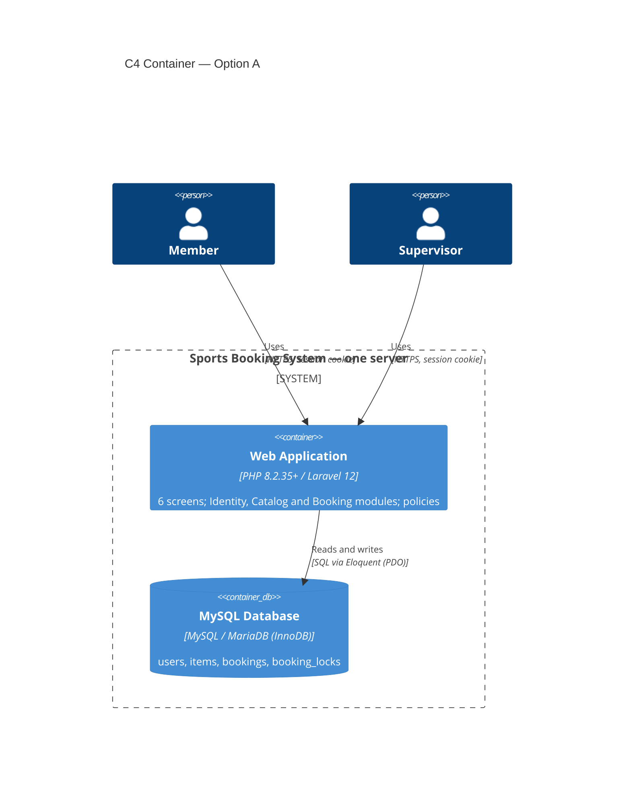
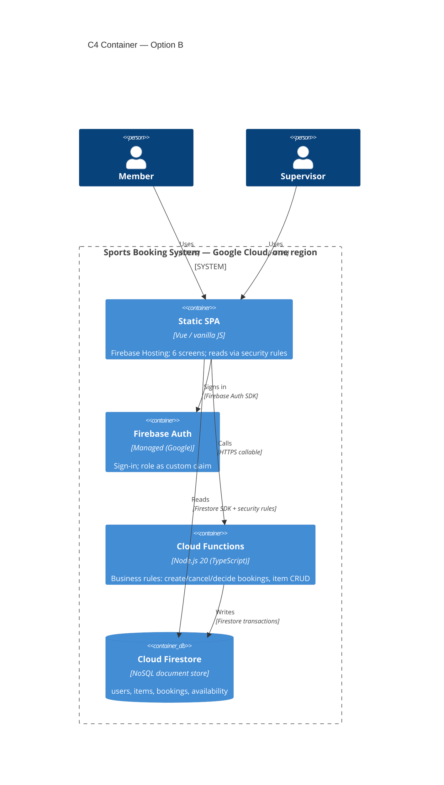
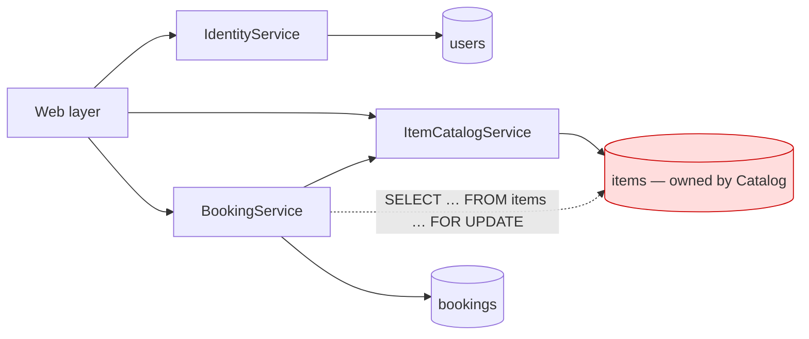
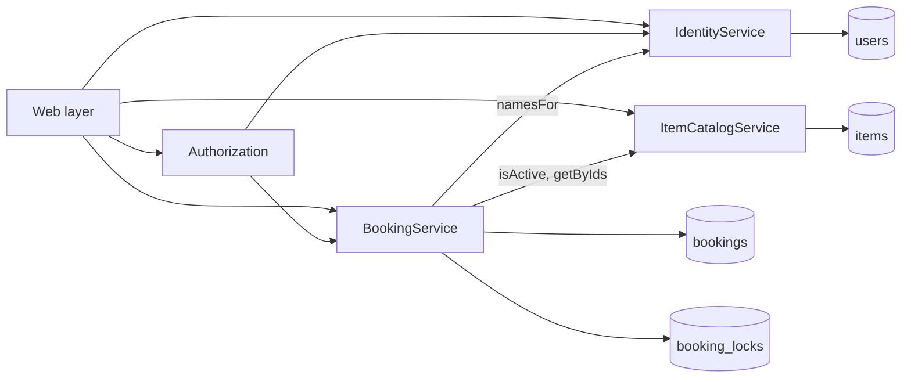

# M1 Architecture — Sports Field & Equipment Booking System

**Status:** v4 — human-reviewed · **Date:** 2026-11-08 · **Author:** Abdullah Alhirbish

---

## 1. Distinctness check — are the two options really different?

| Dimension | Option A — Modular monolith | Option B — Serverless / BaaS |
|---|---|---|
| Architectural style | One server-side application | Managed services + functions, no own server |
| Language / runtime | PHP 8.2.35+ / Laravel 12 | TypeScript / Node.js 20 (Cloud Functions) + browser JS |
| UI rendering | Server-rendered Blade pages | Single-page app in the browser |
| Data store | Relational — MySQL/MariaDB (InnoDB) | Document — Cloud Firestore (NoSQL) |
| Authentication | Laravel session auth, roles in `users.role` | Firebase Auth, roles as custom claims |
| Concurrency control (NFR-04) | Pessimistic DB row lock in a transaction | Optimistic Firestore transaction with retries |
| Access control enforced by | Laravel middleware + policies (server code) | Firestore security rules + function checks |
| Deployment | One deployable on one server | Four managed services (Hosting, Auth, Functions, Firestore) |
| Billing model | Fixed monthly server | Pay-per-use (Blaze plan required for Functions) |

---

## 2. Option A — Server-based web app (PHP 8.2.35+ / Laravel 12, Blade views, no Livewire)

### 2.1 Summary
A single Laravel 12 application (PHP 8.2.35+) renders all six screens with Blade, keeps business rules in one service per module, and stores data in MySQL/MariaDB. The code is split into three modules; **each module owns its tables and other modules may only call its service**, never touch its tables.

**Booking request flow (FR-03, FR-04, FR-13, FR-14, FR-16):**
1. `GET /bookings/create?item=…&date=…` → controller calls `BookingService::bookedRangesFor(item, date)` → returns booked time ranges only, no names (FR-16) → Blade page.
2. Member submits → `POST /bookings` → form request validates times and operating hours (FR-13).
3. Controller calls `BookingService::createRequest(user, item, date, start, end)`:
   - asks Catalog `ItemCatalogService::isActive(item)` (FR-14);
   - opens a DB transaction, takes the lock row in **its own** `booking_locks` table for `(item, date)` (ADR-003);
   - runs the FR-04 overlap query on `bookings`;
   - inserts a `pending` booking, commits.
4. Redirect to My Bookings (FR-10).

### 2.2 C4 Context

No external systems: payment, SMS/WhatsApp and email are non-goals (charter).

### 2.3 C4 Container

### 2.4 Modules

Each module owns its tables and is only reachable through a service interface.
Element IDs are used in `TRACEABILITY.md`.

| ID | Module | Owns | Public interface | Depends on |
|---|---|---|---|---|
| **A-ID** | Identity & Access | `users` | `IdentityService`: register (Member only, FR-15), current user, role, `namesFor(userIds)` | — |
| **A-CAT** | Catalog | `items` | `ItemCatalogService`: listActive, `getByIds(itemIds)`, create, update, deactivate, `isActive` | — |
| **A-BK** | Booking | `bookings`, `booking_locks` | `BookingService`: createRequest, cancel, approve, reject, listForMember, `bookedRangesFor`, `supervisorSchedule` | A-CAT (isActive, getByIds) · A-ID (namesFor) — **interfaces only** |
| **A-WEB** | Web layer | — | Routes, controllers, form requests, Blade views | A-ID, A-CAT, A-BK, A-POL |
| **A-POL** | Authorization | — | Role middleware + `BookingPolicy` (owner check), `supervisor` gate | A-ID (role), A-BK (booking owner) |

**Dependency direction:** `A-WEB → {A-ID, A-CAT, A-BK, A-POL}`, `A-BK → {A-CAT, A-ID}`, `A-POL → {A-ID, A-BK}`. No cycles. A-CAT and A-ID depend on nothing.

**FR-16 vs FR-11:** `bookedRangesFor()` returns start/end only (no names); `supervisorSchedule()` is Supervisor-only.

**No cross-module joins:** `supervisorSchedule()` reads `bookings`, then calls `getByIds()` and `namesFor()` — three queries instead of one join.

### 2.5 Bounded contexts

| Context | Language inside it | Module |
|---|---|---|
| Identity | user, role, member, supervisor | A-ID |
| Catalog | item, field, equipment, active / deactivated | A-CAT |
| Booking (core domain) | booking, slot, interval, conflict, pending / approved / rejected / cancelled | A-BK |

### 2.6 Endpoint list & table list vs ceilings

**Screens (6 / 6):** Login, Register, Request Booking, My Bookings, Supervisor Dashboard, Manage Items.

**Routes — strict count, every method + path:**

| # | Method | Path | Screen | FR | Kind |
|---|---|---|---|---|---|
| 1 | GET | `/login` | Login | FR-02 | view |
| 2 | POST | `/login` | Login | FR-02 | action |
| 3 | GET | `/register` | Register | FR-01 | view |
| 4 | POST | `/register` | Register | FR-01, FR-15 | action |
| 5 | POST | `/logout` | (all) | FR-02 | action |
| 6 | GET | `/bookings/create` | Request Booking | FR-03, FR-16 | view |
| 7 | POST | `/bookings` | Request Booking | FR-03, FR-04, FR-13, FR-14 | action |
| 8 | GET | `/bookings` | My Bookings | FR-10 | view |
| 9 | POST | `/bookings/{id}/cancel` | My Bookings | FR-08 | action (Member, owner only) |
| 10 | GET | `/dashboard` | Supervisor Dashboard | FR-11 | view (Supervisor) |
| 11 | POST | `/dashboard/bookings/{id}/decision` | Supervisor Dashboard | FR-06, FR-07, FR-14 | action (Supervisor) |
| 12 | GET | `/items` | Manage Items | FR-09 | view (Supervisor) |
| 13 | POST | `/items` | Manage Items | FR-09 | action (Supervisor) |
| 14 | POST | `/items/{id}` | Manage Items | FR-09 (edit, deactivate) | action (Supervisor) |

**Total: 14 routes = 6 views + 8 actions.** This is above the 10-endpoint ceiling; the instructor accepted 14 endpoints on 2026-10-21.

**Tables (5 / 8):**

| Table | Owner | Purpose |
|---|---|---|
| `users` | A-ID | name, email (unique), password hash, `role` enum (member, supervisor) |
| `items` | A-CAT | name (unique), `type` enum (field, equipment), `is_active` boolean |
| `bookings` | A-BK | user_id, item_id, date, start_time, end_time, `status` enum, created_at, decided_at |
| `booking_locks` | A-BK | item_id, date — unique; one row per item per day, used only as the lock target |
| `migrations` | framework | Laravel migration history |

Laravel default tables removed: `password_reset_tokens`, `sessions`, `cache`, `cache_locks`, `jobs`, `job_batches`, `failed_jobs` (file drivers, sync queue).

### 2.7 NFR fit (Option A)

| NFR | Design response | Status |
|---|---|---|
| NFR-01 performance | One indexed overlap query on `bookings (item_id, date, status)` + one lock row per item-day | Unknown — measure p95 with 50 concurrent requests in M2 |
| NFR-02 access control | Role middleware on Supervisor routes, `BookingPolicy` owner check on cancel; all in server code | One automated 403 test per protected action (4 actions) in M2 |
| NFR-03 usability | Server-rendered form; booked ranges shown on the same page (FR-16) | Unknown — 5-participant test |
| NFR-04 integrity | Transaction + `SELECT … FOR UPDATE` on `booking_locks(item, date)` serialises all requests for the same item-day; the loser re-reads, sees the overlap and returns a conflict error (ADR-003) | Designed to give 1 committed / 99 conflict; **must be proven** by the 100-request test on MySQL |
| NFR-05 testability | Conflict rule isolated in `BookingService`; PHPUnit/Pest + Infection | Targets checked in M2 |

### 2.8 Risks & weaknesses (Option A)

1. **Test database differs from production** — Laravel 12's default `phpunit.xml` runs tests on in-memory SQLite, where `lockForUpdate()` compiles to nothing, and PHPUnit runs requests one after another in one process. A concurrency test there passes even with no lock. The NFR-04 test must run against MySQL with truly parallel requests (separate processes).
2. **Concurrency correctness is easy to get wrong** — if the conflict `SELECT` runs outside the transaction or before the `booking_locks` row is locked, double bookings appear. Normal one-request tests still pass; only the NFR-04 stress test (100 simultaneous requests on MySQL) catches it.
3. **Endpoint ceiling (14 vs 10)** — accepted by the instructor on 2026-10-21. Any new feature adds endpoints, so new routes need the instructor's approval.
4. **One server** — server, PHP and MySQL patching is my responsibility. The PHP vulnerabilities fixed on 21 Oct 2026 (CVE-2026-109618, CVE-2026-109619) require PHP ≥ 8.2.35, and PHP 8.2 security support ends 31 Dec 2026.

### 2.9 Monthly running cost (Option A)

One small Linux VPS (PHP + MySQL), ~$7/mo (Hetzner CX23, €5.99) when deployed; $0 on local XAMPP. Details: `COST_MODEL.md`.

---

## 3. Option B — Serverless / Backend-as-a-Service (Firebase, Node.js/TypeScript)

### 3.1 Summary

Static SPA calls Firebase Auth (sign-in handled by the SDK, no custom login endpoint) and reads data through Firestore **security rules**. All *mutating* business rules run in **callable Cloud Functions** (HTTPS endpoints), so the client can never bypass the conflict rule.

**Booking flow:** member signs in via Firebase Auth → SPA reads `availability/{itemId}_{date}` (rules grant Members read, no owner info → FR-16) → member picks slot → SPA invokes `createBooking` Cloud Function → function runs a **Firestore transaction** on the `availability` doc: reads booked ranges, checks overlap (FR-04), writes the new range back and inserts the booking with status `pending` → SPA navigates to My Bookings.

### 3.2 C4 Context

No external systems: payment, SMS/WhatsApp and email are non-goals (charter).

### 3.3 C4 Container

### 3.4 Modules (Option B)

| Module | Owns (collections) | Interface / calls |
|---|---|---|
| **Identity/Auth** | `users` + Firebase Auth (role as custom claim) | SDK for sign-in; `register` callable creates the Firebase user and sets the `member` claim (FR-15). Supervisor created by **admin seeding** only. |
| **Catalog** | `items` | `addItem` / `updateItem` / `deactivateItem` callables (FR-09, FR-14). Deactivate = set `is_active=false` (soft), past bookings retained. |
| **Booking** | `bookings` + `availability` | `createBooking` / `cancelBooking` / `decideBooking` callables; all use **transactions on the `availability/{itemId}_{date}` doc** (FR-04, FR-06–08). |
| **Availability / Reporting** | *none* | Read-only via Firestore **security rules** — Members see `availability` (ranges, **no owner**) for FR-16; Supervisors see `bookings` (+item) for FR-11. |

### 3.5 Bounded contexts (Option B)

| Bounded context | Module(s) |
|---|---|
| **Identity** | Identity/Auth |
| **Catalog** | Catalog |
| **Booking** | Booking |
| **Availability / Reporting** | Availability/Reporting (rules-based read model) |

### 3.6 Endpoint list & collection list vs ceilings

**Endpoints (Option B)** — reads are handled by Firestore security rules (not custom HTTP endpoints); only **callable Cloud Functions** count as endpoints:

| # | Callable (HTTPS) | FR | Screen |
|---|---|---|---|
| 1 | `register` | FR-01, FR-15 | Register |
| 2 | `createBooking` | FR-04, FR-13, FR-14 | Request Booking |
| 3 | `cancelBooking` | FR-08 | My Bookings |
| 4 | `decideBooking` | FR-06, FR-07 | Supervisor Dashboard |
| 5 | `addItem` | FR-09 | Manage Items |
| 6 | `updateItem` | FR-09 | Manage Items |
| 7 | `deactivateItem` | FR-09 | Manage Items |

**Total: 7 endpoints** (under 10). Reads go through Firestore security rules; sign-in uses the Firebase Auth SDK.

**Collections (Option B):**

| Collection | Purpose |
|---|---|
| `users` | Role + public profile (synthetic only). |
| `items` | Catalog; `is_active` flag (deactivation). |
| `bookings` | Booking records; status enum, `created_at`, `decided_at`. |
| `availability` | Single doc per `{itemId}_{date}` holding the array of booked ranges — the concurrency gate. |

**Total: 4 collections** (under 8).

### 3.7 NFR fit (Option B)

| NFR | Design response | Status |
|---|---|---|
| NFR-01 performance | Cloud Functions; a cold start can add about 1 s to the first request | Unknown — measure warm and cold p95 |
| NFR-02 access control | Firebase Auth + custom claims; access enforced by Firestore security rules and checks inside each function | Rules are hard to unit-test and easy to misconfigure |
| NFR-03 usability | SPA in the browser | Unknown — requires the 5-participant test |
| NFR-04 integrity | Optimistic Firestore transaction on `availability/{itemId}_{date}`; a retried writer re-reads, sees the overlap and returns a conflict | **Does not meet the measure:** no double booking, but after the retry limit some losers fail with `ABORTED` instead of a conflict error |
| NFR-05 testability | Overlap rule in a pure TypeScript function, Jest + Stryker | Unknown — transactions and rules need the Firestore emulator; toolchain not yet used |

### 3.8 Weaknesses — reasons for rejection

1. **Leaves the declared language.** TypeScript instead of PHP; changing the declared language forfeits the Week 10 mutation-gauntlet marks.
2. **Does not meet NFR-04's measure.** Firestore retries a contended transaction a limited number of times, then fails it with an `ABORTED` error. Under 100 simultaneous requests some losers would get `ABORTED`, not a conflict error, so "99 receive a conflict error" is not guaranteed — even though no double booking occurs. Mitigable with extra retry-and-recheck code.
3. **Breaks module ownership.** The SPA reads `bookings` (Booking) and `items` (Catalog) directly to build the dashboard, because Firestore has no joins — the coupling the design rule forbids.
4. **Security lives in rules.** Access control (NFR-02) depends on Firestore security rules, which are hard to unit-test and easy to misconfigure.
5. **Weaker testability (NFR-05).** Jest + Firestore emulator + Stryker, a toolchain I have not used.
6. **Billing account required.** Cloud Functions need the Blaze pay-as-you-go plan; the free Spark plan cannot deploy them.

### 3.9 Monthly running cost (Option B)

Firebase Auth, Firestore, Cloud Functions, Hosting (`https://firebase.google.com/pricing`). ~$0 within free quotas, but the Blaze billing plan is required for Functions. Details: `COST_MODEL.md`.

---

## 4. Trade-off matrix

| Quality attribute (NFR) | Weight | Option A | Option B | Evidence |
|---|---|---|---|---|
| Fit with declared language | H | PHP 8.2.35+ / Laravel 12, as declared | Leaves PHP (Node.js / TypeScript) | Charter declares PHP; changing it forfeits the Week 10 mutation-gauntlet marks |
| Data integrity (NFR-04) | H | Row lock on `booking_locks` in a transaction: one winner, every loser gets a conflict error | Optimistic transaction: no double booking, but after the retry limit some losers get `ABORTED`, not a conflict error | NFR-04 requires "99 receive a conflict error". B's gap is mitigable with extra retry-and-recheck code. Both to be measured in M2 |
| Testability (NFR-05) | H | PHPUnit/Pest + Infection; conflict rule isolated in one service | Jest + Firestore emulator + Stryker; transactions and rules need the emulator | NFR-05 targets: 80% coverage, 70% mutation score |
| Security (NFR-02) | H | Middleware + policies in server code, testable with PHPUnit | Security rules + custom claims, hard to unit-test and easy to misconfigure | NFR-02: one 403 test per protected action (4 actions) |
| Module ownership (coupling check) | M | No module touches another module's tables; Booking reaches Catalog and Identity through their services | Dashboard reads `bookings` and `items` directly from the browser (Firestore has no joins) | Coupling check, §5 |
| Performance (NFR-01) | M | Unknown — one indexed query + one lock per item-day | Unknown — cold starts can add about 1 s | Neither measured; p95 load test in M2 |
| Usability (NFR-03) | M | Unknown | Unknown | Needs the 5-participant test |
| Operational burden | M | Higher — I patch OS, PHP and MySQL (e.g. PHP CVE-2026-109618, 21 Oct 2026) | Low — managed by Google | Not an NFR; compared by ops task list |
| Cost | M | $0 in development; fixed small Linux VPS when deployed | $0 in development; usage-based, Blaze billing account required | `COST_MODEL.md` |
| Scope ceilings | M | 14 / 10 endpoints (6 views + 8 actions), accepted by the instructor; 5 / 8 tables | 7 / 10 endpoints; 4 / 8 collections | Brief's scope ceilings; §2.6, §3.6 |
| Energy / compute | L | Higher idle (server runs 24/7) | Lower for spiky low load (scales to zero) | Idle model; magnitude not measured |

Option A wins every high-weight row. Option B is better on operational burden, idle energy and the endpoint count.

---

## 5. Coupling check

### 5.1 AI draft, Option A — FLAGGED

| Check | Result |
|---|---|
| Cycles | None |
| Cross-module table access | **FAIL** — `BookingService` locks a row in `items`, which Catalog owns (the draft's NFR-04 mechanism). The same draft states "Places that break the rule: none". |
| Why it matters | If Catalog changes `items`, bookings break without Booking's code being touched. |

### 5.2 Chosen design, Option A — CLEARED

| Check | Result |
|---|---|
| Cycles | None — Identity and Catalog depend on nothing |
| Cross-module table access | **PASS** — Booking touches only `bookings` and `booking_locks`; it reaches Catalog and Identity through their services |
| Bounded contexts | **PASS** — booking vocabulary stays in Booking; "is this item active?" is answered by Catalog |

### 5.3 Residual risk the coupling check cannot reveal

**Check-then-act race on deactivation (FR-14).** `createRequest` asks Catalog `isActive(item)` and *then* locks and inserts. Catalog's `deactivate` runs in a different transaction and does not take the booking lock. If the Supervisor deactivates the item in the gap between the check and the insert, a Pending booking is created for a deactivated item. The dependency graph is clean — Booking calling Catalog's service is allowed — so the check passes; the two modules disagree about *time*, not structure.

**Mitigation:** UC-03 denies *approving* a booking on a deactivated item (FR-14), so it can never become Approved. A test for this goes into M2.

---

## 6. Comparison with the AI draft

The raw DEVAI draft is the first (raw) commit of this file; this version is my reviewed correction.

| # | AI draft said | Problem | My decision |
|---|---|---|---|
| 1 | Booking runs `SELECT … FROM items … FOR UPDATE`, and states "Places that break the rule: none" | Hidden coupling into Catalog's table; the draft contradicts itself | Lock row in Booking's own `booking_locks` table (§5, ADR-003) |
| 2 | Endpoint list: 13 | `POST /logout` missing — real count is 14 | Added; 14 accepted by the instructor |
| 3 | Items deactivated with `is_active` **and** `deleted_at` | Two mechanisms; `SoftDeletes` hides past bookings' item | `is_active` only |
| 4 | NFR-04 "Guaranteed" for both options | Not tested; Option B can return `ABORTED`, not a conflict error | A: "designed to, proven in M2"; B: fails NFR-04's measure |
| 5 | Option B reads `bookings` and `items` directly, not listed as a rule break | Missed coupling | Listed as a reason to reject B (§3.8) |
| 6 | C4 Context declares `bookSys` twice; Option B Container uses `SystemBoundary` | Invalid diagrams — they do not render | Diagrams fixed and render-checked |
| 7 | C4 Context names the technology (Laravel, Firebase) | Technology belongs in the Container level | Context describes users and purpose only |
| 8 | A fourth "Availability View" module in Option A with no tables | Extra module with no data or rules | Folded into Booking as two separate methods |
| 9 | Trade-off cells "Strong", "Good fit", "likely fine" | Opinions without evidence | Evidence per cell; "Unknown" where not measured |
| 10 | Testability weighted M, Cost weighted L | Most M2 marks depend on tests; cost is a quality attribute | Testability H, Cost M |
| 11 | No risk about the test database | Laravel tests run on SQLite, where `lockForUpdate()` does nothing | Added as a risk; NFR-04 test must run on MySQL |
| 12 | Recommendation written as chat to the user ("you already have", "my recommended fix") | Not a design record | Rewritten as the decision (§7) |
| 13 | VPS ≈ $4–6/mo | Price not verified | Re-checked in `COST_MODEL.md` |

---

## 7. Recommendation and accepted downside

**Option A — modular Laravel monolith.** It wins every high-weight row in §4. Rationale and consequences: ADR-001 (§8).

**Accepted downside:** I patch the server myself, and NFR-04 depends on locking code that must be proven by the 100-request test on MySQL in M2.

---

## 8. Architecture Decision Records (ADRs)

MADR format. All Accepted, 2026-11-08, decided by Abdullah Alhirbish.

### ADR-001 — Architecture style
- **Context:** solo, one-semester project; declared language PHP / Laravel 12; NFR-02, NFR-04 and NFR-05 need strong testability and a strict no-double-booking rule.
- **Options:** (A) modular Laravel monolith; (B) serverless Firebase.
- **Decision:** A.
- **Consequences:** + keeps the declared language; NFR-02/04/05 testable with PHPUnit/Pest and Infection (§2.7). − I patch the server myself; 14 endpoints (approved by the instructor, 2026-10-21). B rejected for TypeScript, hard-to-test security rules, `ABORTED` under contention and the Blaze plan (§4).
- **Y-statement:** In the context of a solo PHP project needing strict no-double-booking and high testability, we chose a modular Laravel monolith over Firebase, to keep the declared language and testable guarantees, accepting server patching and 14 endpoints.

### ADR-002 — Database
- **Context:** NFR-04 needs transactions and row locks; development runs on XAMPP.
- **Options:** MySQL/MariaDB (InnoDB); PostgreSQL; SQLite.
- **Decision:** MySQL/MariaDB with InnoDB.
- **Consequences:** + already in XAMPP; supports `SELECT … FOR UPDATE`. − no exclusion constraint, so overlap is enforced in code; the NFR-04 test must run on MySQL, not SQLite (SQLite ignores locks). PostgreSQL rejected: extra setup with no needed benefit.
- **Y-statement:** In the context of a Laravel app on XAMPP needing row locks, we chose MySQL/InnoDB over PostgreSQL and SQLite, to get locking with no extra setup, accepting that overlap is enforced in code and tested on MySQL.

### ADR-003 — Double-booking prevention
- **Context:** two simultaneous requests can both pass the FR-04 check; modules must not lock other modules' tables (§5).
- **Options:** lock the `items` row; lock a row in Booking's own `booking_locks(item_id, date)`; `GET_LOCK`; fixed-slot unique constraint.
- **Decision:** `booking_locks` — transaction → insert-if-absent → `FOR UPDATE` → overlap check → insert → commit.
- **Consequences:** + exactly one winner, 99 conflicts (NFR-04); clean coupling check. − same item/day requests wait briefly; one extra table; must lock *before* checking. `items` lock rejected (coupling), `GET_LOCK` (MySQL-only, manual release), fixed slots (times are free-form).
- **Y-statement:** In the context of simultaneous requests for the same item and day, we chose a lock row in Booking's own `booking_locks` table over locking `items`, `GET_LOCK` or fixed slots, to get one winner and a clean coupling check, accepting short waits and one extra table.
