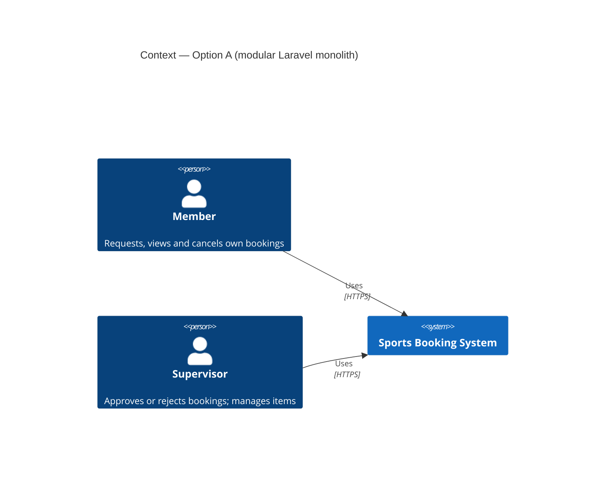
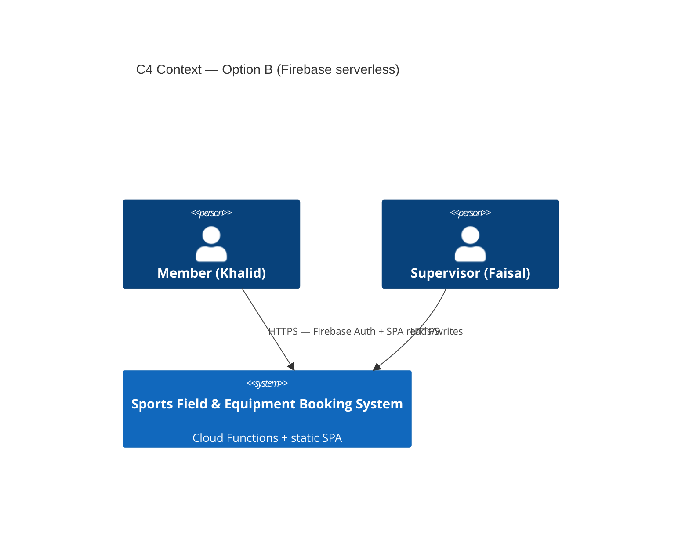
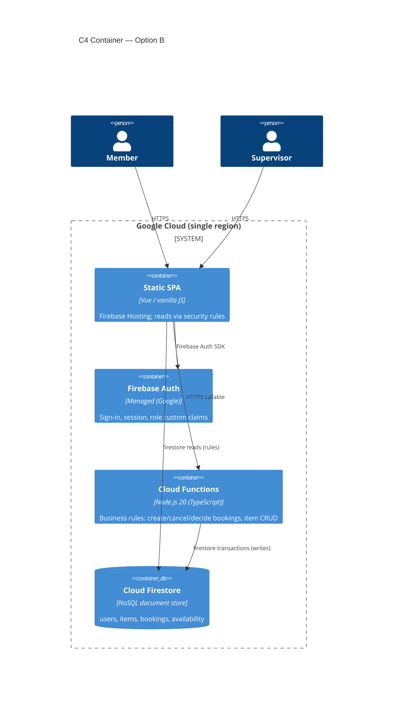

# M1 Architecture — First Draft (Sports Field & Equipment Booking System)

**Milestone:** M1 · **Status:** v3 — human-reviewed · **Date:** 2026-10-21
**Author / reviewer:** Abdullah Alhirbish

**Decision:** Option A — modular Laravel monolith (see ADR-001). Option B — serverless Firebase — was evaluated and rejected.

---

## 1. Distinctness check — are the two options really different?

The first AI draft (v1) offered "Laravel + Blade" vs "Laravel API + SPA": same backend, same database, same modules, same concurrency mechanism, same cost. That is one design with two frontends, so it was rejected and a second draft was requested. The final two options differ on every structural dimension:

| Dimension | Option A — Modular monolith | Option B — Serverless / BaaS |
|---|---|---|
| Architectural style | One server-side application | Managed services + functions, no own server |
| Language / runtime | PHP 8.2 / Laravel 12 | TypeScript / Node.js 20 (Cloud Functions) + browser JS |
| UI rendering | Server-rendered Blade pages | Single-page app in the browser |
| Data store | Relational — MySQL/MariaDB (InnoDB) | Document — Cloud Firestore (NoSQL) |
| Authentication | Laravel session auth, roles in `users.role` | Firebase Auth, roles as custom claims |
| Concurrency control (NFR-04) | Pessimistic DB row lock in a transaction | Optimistic Firestore transaction with retries |
| Access control enforced by | Laravel middleware + policies (server code) | Firestore security rules + function checks |
| Deployment | One deployable on one server | Four managed services (Hosting, Auth, Functions, Firestore) |
| Billing model | Fixed monthly server | Pay-per-use (Blaze plan required for Functions) |

**Result:** distinct — no row is the same.

---

## 2. OPTION A — Server-based web app (PHP 8.2 + Laravel 12, Blade views, no Livewire)

### 2.1 Summary
A single Laravel 12 application (PHP 8.2) renders all six screens with Blade, keeps business rules in one service per module, and stores data in MySQL/MariaDB. The code is split into three modules; **each module owns its tables and other modules may only call its service**, never touch its tables.

**Booking request flow (FR-03, FR-04, FR-13, FR-14, FR-16):**
1. `GET /bookings/create?item=…&date=…` → controller calls `BookingService::memberAvailability(item, date)` → returns booked time ranges only, no names (FR-16) → Blade page.
2. Member submits → `POST /bookings` → form request validates times and operating hours (FR-13).
3. Controller calls `BookingService::createRequest(user, item, date, start, end)`:
   - asks Catalog `ItemCatalogService::isActive(item)` (FR-14);
   - opens a DB transaction, takes the lock row in **its own** `booking_locks` table for `(item, date)` (ADR-003);
   - runs the FR-04 overlap query on `bookings`;
   - inserts a `pending` booking, commits.
4. Redirect to My Bookings (FR-10).

### 2.2 C4 - Context



No external systems: payment, SMS/WhatsApp and email are non-goals (charter).

### 2.3 C4 Container

```mermaid
C4Container
    title C4 Container — Option A
    Person(member, "Member")
    Person(supervisor, "Supervisor")
    SystemBoundary(box, "Sports Booking System — one server") {
        Container(web, "Web Application", "PHP 8.2 / Laravel 12", "6 screens; Identity, Catalog and Booking modules; policies")
        ContainerDb(db, "MySQL Database", "MySQL / MariaDB (InnoDB)", "users, items, bookings, booking_locks")
    }
    Rel(member, web, "HTTPS GET/POST (Blade HTML)")
    Rel(supervisor, web, "HTTPS, session cookie")
    Rel(web, db, "SQL via Eloquent (PDO)")
```

### 2.4 Modules

Each module owns its tables and is only reachable through a service interface.
Element IDs are used in `TRACEABILITY.md`.

| ID | Module | Owns | Public interface | Depends on |
|---|---|---|
| **A-ID** | Identity & Access | `users` | `IdentityService`: register (Member only, FR-15), current user, role, `namesFor(userIds)` | — |
| **A-CAT** | Catalog | `items` | `ItemCatalogService`: listActive, getByIds(itemIds) , create, update, deactivate, `isActive` | — |
| **A-BK** | Booking | `bookings`, `booking_locks` | `BookingService`: createRequest, cancel, approve, reject, listForMember, `bookedRangesFor`, `supervisorSchedule` |A-CAT (isActive, getById, getByIds) · A-ID (namesFor) — **interfaces only** |
| **A-WEB** | Web layer | — | Routes, controllers, form requests, Blade views | A-ID, A-CAT, A-BK, A-POL services |
| **A-POL** | Authorization | — | Role middleware + `BookingPolicy` (owner check), `supervisor` gate | A-ID(role), A-BK(booking owner) |

**Dependency direction:** `A-WEB → {A-ID, A-CAT, A-BK, A-POL}`, `A-BK → {A-CAT, A-ID}`, `A-POL→ {A-ID, A-BK}`. No cycles. A-CAT and A-ID depend on nothing.

**FR-16 vs FR-11 separation:** `bookedRangesFor()` returns a DTO with `start` and `end` only — the user is never loaded. `supervisorSchedule()` is a separate method used only behind the `supervisor` gate. The member page cannot receive names because the method it calls never reads them.

**Module-ownership rule check:** FR-11 (dashboard) needs booking data together with item names and member names — normally a `bookings × items × users` SQL join. To keep each module inside its own tables, `supervisorSchedule()` reads `bookings`, then asks Catalog `ItemCatalogService::getByIds()` and Identity `IdentityService::namesFor()` — three queries instead of one join. A controller running `Booking::join('items')` would break the rule. Accepted cost: three queries instead of one; NFR-01 to be measured in M2.

### 2.5 Bounded contexts

| Context | Language inside it | Module |
|---|---|---|
| Identity | user, role, member, supervisor | A-ID |
| Catalog | item, field, equipment, active / deactivated | A-CAT |
| Booking (core domain) | booking, slot, interval, conflict, pending / approved / rejected / cancelled | A-BK |

### 2.6 Endpoint list & table list vs ceilings

**Screens (6 / 6):** Login, Register, Request Booking, My Bookings, Supervisor Dashboard, Manage Items.
**Routes — strict count, every method + path:**

| # | Method | Path | Screen | FR | Kind |
|---|---|---|---|---|---|
| 1 | GET | `/login` | Login | FR-02 | view |
| 2 | POST | `/login` | Login | FR-02 | action |
| 3 | GET | `/register` | Register | FR-01 | view |
| 4 | POST | `/register` | Register | FR-01, FR-15 | action |
| 5 | POST | `/logout` | (all) | FR-02 | action |
| 6 | GET | `/bookings/create` | Request Booking | FR-03, FR-16 | view |
| 7 | POST | `/bookings` | Request Booking | FR-03, FR-04, FR-13, FR-14 | action |
| 8 | GET | `/bookings` | My Bookings | FR-10 | view |
| 9 | POST | `/bookings/{id}/cancel` | My Bookings | FR-08 | action (Member, owner only) |
| 10 | GET | `/dashboard` | Supervisor Dashboard | FR-11 | view (Supervisor) |
| 11 | POST | `/dashboard/bookings/{id}/decision` | Supervisor Dashboard | FR-06, FR-07, FR-14 | action (Supervisor) |
| 12 | GET | `/items` | Manage Items | FR-09 | view (Supervisor) |
| 13 | POST | `/items` | Manage Items | FR-09 | action (Supervisor) |
| 14 | POST | `/items/{id}` | Manage Items | FR-09 (edit, deactivate) | action (Supervisor) |

**Total: 14 routes = 6 views + 8 actions.**


**Tables — Option A:**

**Tables (5 / 8):**
| Table | Owner | Purpose |
| `users` | A-ID | name, email (unique), password hash, `role` enum (member, supervisor) |
| `items` | A-CAT | name (unique), `type` enum (field, equipment), `is_active` boolean |
| `bookings` | A-BK | user_id, item_id, date, start_time, end_time, `status` enum, created_at, decided_at |
| `booking_locks` | A-BK | item_id, date — unique; one row per item per day, used only as the lock target |
| `migrations` | framework | Laravel migration history |

Laravel 12 default tables removed: `password_reset_tokens` (non-goal), `sessions` (file session driver), `cache`, `cache_locks` (file cache driver), `jobs`, `job_batches`, `failed_jobs` (sync queue, no background jobs).

Deactivation uses `is_active = false`, **not** Laravel `SoftDeletes`: soft-deleted rows are hidden from every query, so the dashboard would lose the item name of past bookings.

### 2.7 NFR fit (Option A)

| NFR | Design response | Status |
|---|---|---|
| NFR-01 performance | One indexed overlap query on `bookings (item_id, date, status)` + one lock row per item-day | Unknown — measure p95 with 50 concurrent requests in M2 |
| NFR-02 access control | Role middleware on Supervisor routes, `BookingPolicy` owner check on cancel; all in server code | One automated 403 test per protected action (4 actions) in M2 |
| NFR-03 usability | Server-rendered form; booked ranges shown on the same page (FR-16) | Unknown — 5-participant test |
| NFR-04 integrity | Transaction + `SELECT … FOR UPDATE` on `booking_locks(item, date)` serialises all requests for the same item-day; the loser re-reads, sees the overlap and returns a conflict error (ADR-003) | Designed to give 1 committed / 99 conflict; **must be proven** by the 100-request test on MySQL |
| NFR-05 testability | Conflict rule isolated in `BookingService`; PHPUnit/Pest + Infection | Targets checked in M2 |

### 2.8 Risks & weaknesses (Option A)

1. **Test database differs from production** — Laravel 12's default `phpunit.xml` runs tests on in-memory SQLite, where `lockForUpdate()` compiles to nothing, and PHPUnit runs requests one after another in one process. A concurrency test there passes even with no lock. The NFR-04 test must run against MySQL with truly parallel requests (separate processes).
2. **Concurrency correctness is easy to get wrong** — if the conflict `SELECT` runs outside the transaction or before the `booking_locks` row is locked, double bookings appear. Normal one-request tests still pass; only the NFR-04 stress test (100 simultaneous requests on MySQL) catches it.
3. **Endpoint ceiling breach (14 vs 10)** 
4. **One server** — server, PHP and MySQL patching is my responsibility; PHP 8.2 security support ends 31 Dec 2026.

### 9. Monthly running cost (Option A)

- **Services:** one Linux VPS (PHP 8.2.35++ MySQL) **or** a shared PHP host.
- **Provider / pricing:** Hetzner (`https://www.hetzner.com/cloud`) or DigitalOcean (`https://www.digitalocean.com/pricing`). Representative: ~$4–6/mo for 1 vCPU/1–2 GB/20 GB SSD. [ASSUMPTION — verify current price.]
- **Usage assumptions:** synthetic data, low concurrency; 1 vCPU / 1–2 GB RAM / ~20 GB is ample.
- **Tier required:** cheapest paid VPS. **Free tier:** local XAMPP dev is $0; a public always-on single server has no true free tier except limited options (e.g. Oracle Cloud free ARM VPS) which carry provisioning and availability caveats. [ASSUMPTION]
- **M1 stage cost:** $0 (runs on local XAMPP); ~$5/mo only if publicly deployed.

Full calculation, verified prices and DEVAI token cost: `docs/cost-model.md`.

---

## 3.OPTION B — Serverless / Backend-as-a-Service (Firebase, Node.js/TypeScript)

**Deliberately different:** managed BaaS (Firebase Auth + Firestore + Cloud Functions) with a static single-page frontend on Firebase Hosting. **Does not use PHP.** Runtime: **Node.js 20 (TypeScript)** for Cloud Functions; browser SPA (Vue or vanilla JS) for the frontend.

### 3.1 Summary

Static SPA calls Firebase Auth (sign-in handled by the SDK, no custom login endpoint) and reads data through Firestore **security rules**. All *mutating* business rules run in **callable Cloud Functions** (HTTPS endpoints), so the client can never bypass the conflict rule.

**Booking flow:** member signs in via Firebase Auth → SPA reads `availability/{itemId}_{date}` (rules grant Members read, no owner info → FR-16) → member picks slot → SPA invokes `createBooking` Cloud Function → function runs a **Firestore transaction** on the `availability` doc: reads booked ranges, checks overlap (FR-04), writes the new range back and inserts the booking with status `pending` → SPA navigates to My Bookings.

### 3.2 C4 Context



### 3.3 C4 Container



### 3.4 Modules (Option B)

| Module | Owns (collections) | Interface / calls |
|---|---|---|
| **Identity/Auth** | `users` + Firebase Auth (role as custom claim) | SDK for sign-in; `register` callable creates the Firebase user and sets the `member` claim (FR-15). Supervisor created by **admin seeding** only. |
| **Catalog** | `items` | `addItem` / `updateItem` / `deactivateItem` callables (FR-09, FR-14). Deactivate = set `is_active=false` (soft), past bookings retained. |
| **Booking** | `bookings` + `availability` | `createBooking` / `cancelBooking` / `decideBooking` callables; all use **transactions on the `availability/{itemId}_{date}` doc** (FR-04, FR-06–08). |
| **Availability / Reporting** | *none* | Read-only via Firestore **security rules** — Members see `availability` (ranges, **no owner**) for FR-16; Supervisors see `bookings` (+item) for FR-11. |

### 3.5 Bounded contexts (Option B)

| Bounded context | Module(s) |
|---|---|
| **Identity** | Identity/Auth |
| **Catalog** | Catalog |
| **Booking** | Booking |
| **Availability / Reporting** | Availability/Reporting (rules-based read model) |

### 3.6 Endpoint list & collection list vs ceilings

**Endpoints (Option B)** — reads are handled by Firestore security rules (not custom HTTP endpoints); only **callable Cloud Functions** count as endpoints:

| # | Callable (HTTPS) | FR | Screen |
|---|---|---|---|
| 1 | `register` | FR-01, FR-15 | Register |
| 2 | `createBooking` | FR-04, FR-13, FR-14 | Request Booking |
| 3 | `cancelBooking` | FR-08 | My Bookings |
| 4 | `decideBooking` | FR-06, FR-07 | Supervisor Dashboard |
| 5 | `addItem` | FR-09 | Manage Items |
| 6 | `updateItem` | FR-09 | Manage Items |
| 7 | `deactivateItem` | FR-09 | Manage Items |

**Total: 7 endpoints.** ✅ Under the 10 ceiling. (Sign-in/login is Firebase Auth SDK, not a custom endpoint; FR-15's "supervisor only via seeding" is a one-off admin script.) `decideBooking` handles approve+reject as a **single Supervisor** action; `cancelBooking` is a separate **Member** action — Member/Supervisor endpoints are **not** shared.

**Collections (Option B):**

| Collection | Purpose |
|---|---|
| `users` | Role + public profile (synthetic only). |
| `items` | Catalog; `is_active` flag (deactivation). |
| `bookings` | Booking records; status enum, `created_at`, `decided_at`. |
| `availability` | Single doc per `{itemId}_{date}` holding the array of booked ranges — the concurrency gate. |

**Total: 4 collections.** ✅ Under 8. (Firebase Auth users are a separate system, not a Firestore collection; there are **no** framework session/cache/jobs tables, so no defaults to strip.)

### 3.7 NFR fit (Option B)

- **NFR-01 (performance):** Risk — Cloud Functions **cold starts** can add ~1 s latency; at 50 concurrent with warm functions, likely fine. **Unknown until measured under cold+warm load.**
- **NFR-02 (security/access control):** auth (managed Firebase Auth) but the security model rests on **security rules + custom claims**, which are easy to mis-configure; needs the automated 403-per-protected-action tests.
- **NFR-03 (usability):** SPA; pass rate / median **Unknown until the 5-participant test**.
- **NFR-04 (data integrity):** “Does not meet the measure”
- **NFR-05 (testability):** | NFR-05 testability | Overlap rule kept in a pure TypeScript function inside `createBooking`, unit-tested with Jest; coverage from Jest; mutation testing with Stryker (TypeScript) | Unknown — the 80% / 70% targets are possible in principle, but the transaction and the security rules can only be tested against the Firestore emulator, and Jest, the emulator and Stryker are a toolchain not yet used |

### 3.8 Weaknesses — reasons for rejection 
1. **Does not meet NFR-04's measure.** Firestore retries a contended transaction a limited number of times, then fails it with an `ABORTED` error. Under 100 simultaneous requests some losers would get `ABORTED`, not a conflict error, so "99 receive a conflict error" is not guaranteed — even though no double booking occurs.
2. **Breaks module ownership.** The SPA reads `bookings` (Booking) and `items` (Catalog) directly to build the dashboard, because Firestore has no joins — the coupling the design rule forbids.
3. **Security lives in rules.** Access control (NFR-02) depends on Firestore security rules, which are hard to unit-test and easy to misconfigure.
4. **Billing account required.** Cloud Functions need the Blaze pay-as-you-go plan; the free Spark plan cannot deploy them.
5. **Weaker testability (NFR-05).** Jest + Firestore emulator + Stryker, a toolchain I have not used.

### 3.9 Monthly running cost (Option B)

- **Services:** Firebase Auth, Cloud Firestore, Cloud Functions, Firebase Hosting.
- **Provider / pricing:** `https://firebase.google.com/pricing`; Cloud Functions `https://cloud.google.com/functions/pricing`.
- **Usage assumptions:** synthetic data, peak concurrency ~50 for short bursts. 
- **Plan tier required:** Firebase **Blaze** (pay-as-you-go) to run Cloud Functions — free "Spark" cannot run functions; within free quotas it's ~$0, but Blaze is a billing-required plan. Firestore/Auth/Hosting have free quotas on Spark. [ASSUMPTION — verify current tier rules.]
- **Expected M1 cost:** ~$0 if usage stays within Blaze free quota; could be a few cents/mo if exceeded.

---

## Trade-off matrix

| Quality attribute (NFR) | Weight | Option A | Option B | Evidence |
|---|---|---|---|---|
| Fit with declared language | H | PHP 8.2 / Laravel 12 as declared | deliberately leaves PHP (needs Node/TS) | Charter's declared implementation language |
| Performance (NFR-01) | M | Unknown — one index query + one lock per item-day | unknown — cold-start latency  | NFR-01: both score "Unknown until load-tested" |
| Security (NFR-02) | H | centralized (middleware/policies) testable with PHPUnit | rules/claims, hard to unit-test and easy to misconfigure | NFR-02: 403-per-action tests required in both |
| Data integrity (NFR-04) | H | Row lock on `booking_locks` in a transaction: one winner, every loser gets a conflict error  | Optimistic transaction: no double booking, but after the retry limit some losers get `ABORTED`, not a conflict error | NFR-04 requires "99 receive a conflict error". B's gap is mitigable with extra retry-and-recheck code. Both to be measured in M2|
| Testability (NFR-05) | H | (PHPUnit/Pest + Infection) | (Jest + emulator + Stryker) | NFR-05 targets: 80% coverage, 70% mutation score|
| Usability (NFR-03) | M | Unknown | Unknown | NFR-03: pass rate/median **Unknown until tested** |
| Operational burden | M | Higher — you patch OS/PHP/MySQL | Low — managed services | Not an NFR; compared by ops task list |
| Cost | M | 0 $0 in development; fixed small Linux VPS when deployed |  $0 in development; usage-based, Blaze billing account required | `docs/cost-model.md` |
| Energy / compute | L | Higher idle (server runs 24/7) | Lower for spiky low load (scales-to-zero) | Comparison by payment/idle model, not measured |
| Module ownership (coupling check) | M | No module touches another module's tables; Booking reaches Catalog and Identity through their services | Dashboard reads `bookings` and `items` directly from the browser (Firestore has no joins) | Coupling check |
| Scope ceilings | M | 14 / 10 endpoints (6 views + 8 actions) 5 / 8 tables | 7 / 10 endpoints; 4 / 8 collections | Brief's scope ceilings; §2.6, §3.4 |


---

## Recommendation and accepted downside

**Recommendation: Option A (PHP 8.35 / Laravel 12 + Blade).**

Reasons: it matches the charter's declared language (a strong, explicit constraint), keeps the whole toolchain on the XAMPP environment you already have, is the most testable against NFR-05, and its data-integrity mechanism (InnoDB row locks) is directly proveable on the stated MySQL/MariaDB. Option B is a valid alternative that better fits the endpoint ceiling and reduces operational burden, but it abandons the declared PHP stack, introduces Firebase Blaze billing, and makes FR-04 correctness depend on a single hot document.

**Main accepted downside:** Option A's strict endpoint count is **13, which breaches the 10-endpoint ceiling** (and it keeps you responsible for server/ops). Before this design is signed off, you must resolve the ceiling with your instructor — either accept ~13 endpoints (my recommended fix: keep all 6 screens) or fold the Manage Items list into the dashboard and cut endpoints. The other downside is that you own the server, so its security patching and the concurrency stress test fall on you.

---

Two checks for your review before you finalize: (1) confirm the **endpoint ceiling** interpretation for Option A — this is the one hard conflict I could not make both options pass; and (2) confirm whether the course permits a **Node/TS non-PHP** stack for Option B, since that governs whether Option B is even a credible alternative.
